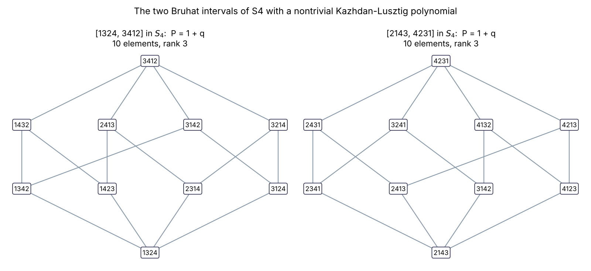
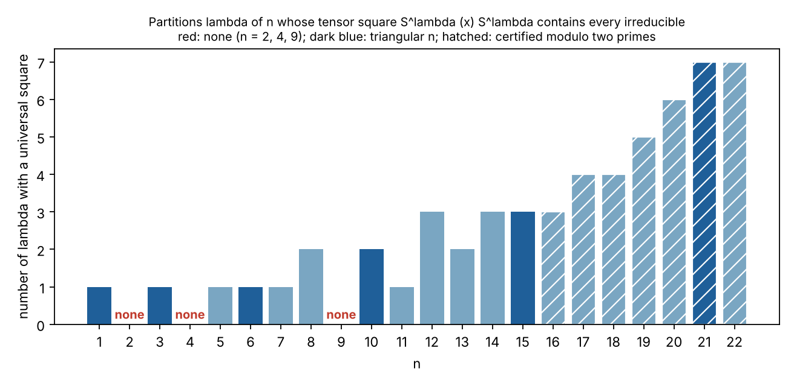

# Combinatorics and Representation Theory: Kazhdan–Lusztig Invariance, Shareshian–Wachs and Saxl

A reading guide to three results on symmetric groups, Coxeter groups and symmetric functions: **combinatorial invariance of Kazhdan–Lusztig polynomials** (entry 168), **elementary positivity of chromatic quasisymmetric functions**, which is the Shareshian–Wachs conjecture (entry 169), and **Saxl's conjecture with the tensor-square conjecture for symmetric groups** (entry 205). It is a fork-level note, not an official OpenAI document. It includes small exact computations that reproduce known cases ([tools/combinatorics_checks.py](tools/combinatorics_checks.py)); none of them tests a theorem beyond the range stated.

**How to read the evidence.** Claims are tagged:
- **[source]**: stated in a paper, read in its extracted text; section, theorem and page numbers are printed ones.
- **[computed]**: produced by `tools/combinatorics_checks.py` (`make combinatorics`).
- **[mine]**: a comparison or interpretation of this fork.
- *(background)*: general knowledge, not from a source here.

## A numbering note

The request that started this page numbered "Shareshian–Wachs" 168 and "Saxl" 169. In [CONTENTS.md](CONTENTS.md) the entries are:

| CONTENTS entry | Title | Papers |
|---|---|---|
| **168** | Combinatorial invariance of Kazhdan–Lusztig polynomials | 1 |
| **169** | Elementary positivity of chromatic quasisymmetric functions (the paper in which the Θ sections appear) | 1 |
| **205** | Saxl's conjecture and universal tensor squares | 2 |

This page uses the CONTENTS numbers. The commentary's remark "I've gone through 169 in some detail … namely the Θ basis" is read here as being about the elementary-positivity paper, which is entry 169 in CONTENTS and the only one of the three that contains Θ.

### Citation keys

| Key | Paper | Entry | Pages |
|---|---|---|---|
| **[KL]** | [Combinatorial invariance of Kazhdan–Lusztig polynomials](preprints/Combinatorial-Invariance-of-Kazhdan-Lusztig-Polynomials-September-24-2026/) | 168 | 31 |
| **[SW]** | [Elementary positivity of chromatic quasisymmetric functions](preprints/Elementary-Positivity-of-Chromatic-Quasisymmetric-Functions-September-24-2026/) | 169 | 51 |
| **[UTS]** | [Universal tensor squares for symmetric groups](preprints/Universal-Tensor-Squares-for-Symmetric-Groups-September-24-2026/) | 205 | 37 |
| **[CPT]** | [A cyclic polytabloid proof of Saxl's conjecture](preprints/A-Cyclic-Polytabloid-Proof-of-Saxls-Conjecture-September-24-2026/) | 205 | 17 |

All four are dated 24 September 2026, with author line "OpenAI". None of [KL], [SW] cites another repository paper; [UTS] cites [CPT].

## Summary

| | Result | How it is proved, in one line | Heavy tools |
|---|---|---|---|
| **[KL]** | An isomorphism of Bruhat intervals in *any* Coxeter system (equal parameters) preserves the Kazhdan–Lusztig polynomial | Compare two moment-graph sheaves along a "transported schedule"; a product of nonnegative matrices pinned to Dyer's path formula forces exact equalities; simultaneous induction on interval rank | Soergel bimodule / Elias–Williamson character theorem; Braden–MacPherson–Fiebig sheaves; Dyer's reflection orders |
| **[SW]** | χ_G(X; q) is a nonnegative-integer-coefficient combination of elementary symmetric functions with coefficients in ℕ[q], for every natural unit interval graph, with an explicit permutation witness | Identify graph-alphabet monomial symmetric functions with single positive "theta sections" of a wall-crossing system on a quantum torus; extract a permutation by a finite matching argument | Hall-algebra / cohomological Hall methods; theta functions and scattering diagrams |
| **[CPT]** | Saxl's conjecture: S^{ρ_m} ⊗ S^{ρ_m} contains every irreducible representation of S_{m(m+1)/2}, ρ_m the staircase | One explicit cyclic module inside the tensor square already contains every irreducible; induction by cutting off a band | Elementary: Specht modules, Pieri and Young's rule, 2×2 matrix contractions. No computer |
| **[UTS]** | For every n ∉ {2, 4, 9} some irreducible of S_n has a tensor square containing every irreducible (the tensor-square conjecture) | A fixed self-conjugate partition per degree; two sufficient tests (band, balance); exhaustion by capacity counts; n ≤ 64 by exact character calculations | [CPT]'s cyclic staircase theorem; computer for n ≤ 64 and nineteen parameter pairs |

## 1. Entry 168: combinatorial invariance of Kazhdan–Lusztig polynomials

### What is proved [source]

[KL] Theorem 1.1 (p. 2): let (W, S) and (W′, S′) be arbitrary Coxeter systems, u ≤ b in W and u′ ≤ b′ in W′. If ι : [u, b] → [u′, b′] is an isomorphism of abstract Bruhat interval posets, then P^W_{u,b}(q) = P^{W′}_{u′,b′}(q) for the equal-parameter Kazhdan–Lusztig polynomials. "The statement includes infinite and noncrystallographic groups." The isomorphism is only an order bijection: "it carries no labels or root data". Corollary 6.1 (p. 29): ι also preserves every P_{x,y} on subintervals and all R-polynomials.

The conjecture is "attributed to Lusztig and Dyer"; Dyer's published formulation, for finite Coxeter systems, is in the paper's ref. [17, §3.5], and his reconstruction of the directed Bruhat graph from the interval order supplies all reflection edges but no root labels. (The attribution sentence cites "[11]", which in the bibliography is Delanoy's paper; this looks like a citation slip in the source and I have not tried to resolve it.) Only equal parameters are treated; no unequal-parameter statement appears.

### Where it sits [source], §1.1 (pp. 2–3)

| Known before | Scope |
|---|---|
| Special matchings; du Cloux (finite and affine classes); Brenti (symmetric groups) | Principal lower intervals [1, b] |
| Brenti–Caselli–Marietti, and Delanoy | Lower intervals in arbitrary Coxeter systems: their input includes the positions of x and y inside the supplied principal lower interval, while the general conjecture asks for P_{x,y} from the abstract interval [x, y] alone |
| Incitti (short intervals, classical types), Patimo (coefficient of q, simply laced Weyl groups), Barkley–Gaetz–Lam (coefficient of q in all Coxeter systems; full invariance up to interval rank six), Esposito–Marietti–Stella (rank ten for finite Weyl groups, twelve in finite type A) | Partial results for intervals with arbitrary bottom element |
| Blundell–Buesing–Davies–Veličković–Williamson (hypercube decompositions in S_n, guided by analysis of trained machine-learning models); Barkley–Gaetz | BBDVW proved a recurrence for one decomposition and conjectured it for all; Barkley–Gaetz proved it for every hypercube decomposition of a principal lower interval [1, v] in S_n. The paper's proof does not use this approach |

### The mechanism [source], §1.2 (pp. 3–4)

1. For a top element b, the Braden–MacPherson–Fiebig sheaf B(b) on the Bruhat moment graph has vertex modules B^x, free over a real polynomial ring A, with graded rank P_{x,b}(q) (Elias–Williamson character theorem). For a set F of upward edges at x, L_x(F) = ker(B^x → ⊕_{e∈F} B^e). The two extreme cases are known: L_x(∅) = B^x, and the kernel for all upward edges is free of graded rank q^{ℓ(b)−ℓ(x)}P_{x,b}(q^{−1}). The intermediate kernels are what must be shown free.
2. Pick a reflection order in the *second* Coxeter system and use its labels to order the edges of the *first* interval through ι: a **transported schedule**. It need not be a reflection order in the first system.
3. **Local step.** Localization at a plane of root labels cuts the sheaf into rank-one dihedral models; dihedral intervals transport through ι (Theorem 3.4 shows ι preserves the directed Bruhat graph; Prop 3.5 transports dihedral intervals without matching root labels). The result for an edge e : x → y is a graded inclusion I_e ⊂ f_e·J_e with deg f_e = (ℓ(y) − ℓ(x) − 1)/2 (Prop 5.2), assuming only freeness of L_y(G).
4. **Global step.** Remove edge conditions in schedule order. At a real 0 < q < 1 the inclusions bound the growth of Hilbert series by a product of nonnegative elementary matrices (diagonal entries one). That product counts decreasing paths for the reflection order in the second system, so Dyer's path formula identifies it with that system's normalized R-matrix. Reciprocity in both directions gives equality of polynomials. Because the matrices are nonnegative with unit diagonal, equality at the ends forces every intermediate bound to be exact (I_e = f_e J_e), which adds the bottom conditions back and proves freeness: this closes a **simultaneous induction on interval rank** of polynomial invariance and freeness of all terminal kernels (Figure 2, p. 27).

The only data of the interval used is its poset structure; root labels are not recovered. Special matchings, the R-polynomial recursion, hypercube decompositions and machine learning are not used.

### Inputs, status and limits [source]

- Deep external inputs: Elias–Williamson (Annals 2014), Fiebig, Braden–MacPherson, Soergel, and Dyer's reflection-order path formula. The paper adds a reflection-faithful real realization of minimal dimension (Lemma 2.1) to apply them to arbitrary Coxeter groups, and checks grading and shift conventions between Fiebig's and Elias–Williamson's (pp. 8–10). Infinite groups are handled by reduction to finite rank (§2.1).
- Some background is hard to check: Dyer's "Rank two detection of singularities of Schubert varieties" is cited as an unpublished, undated manuscript, and his 1987 thesis as an author's PDF.
- Theorem 2.3 states that no freeness is asserted for an arbitrary subset of upward edges; freeness is proved only for the subsets the induction needs.

### Lean [source and observation]

`lean/docs/168.md` says the formalization proves that every order isomorphism between Bruhat intervals in arbitrary Coxeter systems preserves the equal-parameter Kazhdan–Lusztig polynomial, the two intervals possibly from different systems. `ComparatorChallenges/KLInvariance.lean` states `OAI.KLInvariance.combinatorial_invariance` with `sorry` (the comparator stub); the solution directory `OAI/RepresentationTheory/KazhdanLusztig/` has 34 files (about 42,900 lines) with no `sorry`, `axiom` or `native_decide` by search, and its file names track the paper's pieces (`DyerPaths`, `ReflectionOrders`, `PlaneLocalization`, `TerminalKernels`, `SimultaneousInvariance`, …). `formalization.yaml` has no entry for it. **No build was run**; no build log is in the repository.

### A small check [computed]

The script builds all Kazhdan–Lusztig polynomials of S_n by the standard recursion, groups all Bruhat intervals by isomorphism class of the *abstract poset* (networkx), and asks whether a class ever carries two polynomials:

| Group | Bruhat intervals | Poset-isomorphism classes | Classes with two polynomials | Distinct polynomials |
|---|---|---|---|---|
| S₃ | 19 | 4 | 0 | 1 |
| S₄ | 213 | 14 | 0 | 2 |
| S₅ | 3,781 | 91 | 0 | 5 |

In S₄ the only nontrivial polynomials are 1 + q, on the two ten-element rank-3 intervals [1324, 3412] and [2143, 4231] ([figures/comb_fig1_kl_intervals.png](figures/comb_fig1_kl_intervals.png)). I checked that these two intervals are isomorphic as posets (10 elements each), so they are an instance of the theorem's hypothesis, even though they sit in different places in S₄.



This reproduces known small cases (the paper's §1.1 cites full invariance through rank ten in finite Weyl groups, from other authors). It is a sanity check on my implementation and on the statement, not a test of the theorem for infinite or non-crystallographic groups.

## 2. Entry 169: elementary positivity of chromatic quasisymmetric functions

### What is proved [source]

For a weakly increasing h with i ≤ h(i) ≤ n, the natural unit interval graph G has edges {i, j} with i < j ≤ h(i). Its chromatic quasisymmetric function is χ_G(X; q) = Σ over proper colorings f of q^{asc_G(f)} ∏ x_{f(a)}, where asc_G(f) counts edges {a < b} with f(a) < f(b). Shareshian and Wachs proved symmetry and Schur positivity and conjectured elementary positivity over ℕ[q].

[SW] Theorem 1.1 (p. 2): there is a deterministic terminating procedure which, given G and a permutation σ ∈ D′_G (no adjacent descents between non-neighbours), returns a partition θ_G(σ) ⊢ n with

χ_G(X; q) = Σ_{σ ∈ D′_G} q^{ginv_G(σ)} e_{θ_G(σ)}(X),

where ginv_G counts inversions supported on edges. Every elementary coefficient therefore lies in ℕ[q]. The example (1.3), the path 1–2–3, is χ_G = q e_{(2,1)} + (1 + q + q²) e_{(3)}, with D′_G = {123, 132, 213, 321} and graph-inversion degrees 0, 1, 1, 2.

**What it does not assert.** "The theorem makes no assertion of elementary unimodality." There is no polynomial-time bound (Remark 7.1); the procedure is not given the elementary coefficient list. Specializing at q = 1 recovers the classical Stanley–Stembridge positivity, "previously established by Hikita"; the paper notes that Hikita's formula gives numerical nonnegativity for every positive real q but does not establish coefficientwise nonnegativity in ℕ[q].

**Corollary 1.2 (p. 4).** For regular semisimple S, the cohomology of the Hessenberg variety under Tymoczko's dot action decomposes as H^{2d}(Hess(S,h); ℂ) ≅ ⊕_{λ⊢n} (M^λ)^{m_{λ,d}(h)}, with M^λ the Young permutation module and m_{λ,d} = #{σ ∈ D′_G : θ_G(σ) = λ, ginv_G(σ) = d}. It uses Brosnan–Chow and Guay-Paquet and "supplies no preferred isomorphism, geometric basis, or compatibility with cup product".

### On the Θ sections [source, with my reading marked]

The request notes that the key insight "seems to have been relating an existing research program to a highly structured setting with powerful tools available (namely the Θ basis)." Here is what the paper itself says about Θ.

- **What Θ is.** Not a basis of symmetric functions. It is a family of *sections* of a wall-crossing (scattering-diagram) system on a completed quantum torus, one for each lattice exponent m (§4, p. 25). Walls come from factorizations g = g₊g₀g₋ of elements of a completed positive group; a section is "a family of values transported by these consistent wall operations". The incoming coefficient is A_n(F) = [X_n] F(V(n) + ε) (4.9). Θ_m is the unique section supported in m + C⁺ with A_n(Θ_m) = 1 if n = m and 0 otherwise (4.10); within a finite union of translates of C⁺, F = Σ A_n(F) Θ_n (4.11). The paper says this "plays the role of the theta functions in the scattering framework" of Gross–Hacking–Keel–Kontsevich and Davison–Mandel, but that "the definition and positivity argument … use only the explicit coefficient recursion in our convention".
- **Positivity.** Theorem 4.4: every Θ_m has coefficients in ℕ((v⁻¹)) in every chamber; Corollary 4.5: structure constants of products of Θ's lie in ℕ((v⁻¹)). Positivity of wall factors rests on Theorem 3.1, a *positive reordering* of products of quantum elementary units, proved by Hall-algebra methods (shuffle algebras, filtrations, coproducts, primitives; Kontsevich–Soibelman, Reineke, Davison–Meinhardt, Efimov, Franzen–Reineke).
- **The identification that does the work.** [e_λ]χ_G(X; v²) = v^M [X_u] m_λ(Y), where Y is a formal alphabet built from sums E_k of monomials over independent k-sets in a larger natural unit interval graph (1.4); the E_k commute (Prop 2.2). The central identity (1.5), proved as Theorem 5.8 (p. 38), is m_λ(Y) = Θ_{λ₁d₁+…+λ_D d_D}, where d₁,…,d_D are "anchor" vertices of a triangular arrangement, with E_k = Θ_{d₁+…+d_k} (5.21). Together with positivity of Θ this already gives coefficientwise elementary positivity (Corollary 5.9).
- **A caveat the authors state themselves** (p. 5): "general positivity of theta sections does not itself show that a graph-alphabet monomial symmetric function is one such section. The triangular chart below proves that identity before the packet construction extracts the individual witness." And: "A support argument using positive powers of E₁ is essential: stationarity under the rotations alone does not force an exponent to involve anchors only."
- **The permutation witness (§6)** is a separate finite construction: histories counted by [X_u]Θ_{x_μ}, a local packet bijection, and finite matching cancellation of Garsia–Milne type, with termination guaranteed without consulting the final shape counts.

**My reading [mine].** The summary in the request is consistent with the paper: a combinatorial conjecture is transferred into a setting (quantum tori, wall-crossing, theta-type sections) where positivity theorems exist. But the paper's own account puts the new work in two places: proving the transfer, i.e. identifying m_λ(Y) with a single section through the triangular chart and rotations, and extracting an individual witness permutation. Positivity of the sections is not by itself the argument. How new this is relative to the literature is not something I can judge; the paper cites independent recent proofs of the classical q = 1 case (Hikita; Griffin–Mellit–Romero–Weigl–Wen via Macdonald expansions; Huh et al.) and says [SW] gives "a formal polynomial formula with nonnegative integer coefficients and an individual assignment".

### Lean [source and observation]

`lean/docs/169.md` says the formalization proves the statement over ℕ[q]: an explicit expansion indexed by nondescent permutations, each weighted by q to a power determined by graph inversions, for every number of colour variables. The Lean statement asserts the *existence* of a partition-valued witness function; the "deterministic terminating procedure" clause of Theorem 1.1 is not part of the formal statement. The challenge file has `sorry` (comparator stub); the solution tree `OAI/Combinatorics/Chromatic/` has 549 files and about 74,600 lines, with subfolders `QuantumTorus`, `Walls`, `Shuffle`, `Histories`, `Witness`, `GradedAlgebra`, and no `sorry`, `axiom` or `native_decide` by search. **No build was run.**

### A small check [computed]

For every natural unit interval graph on n ≤ 6 vertices (1 + 2 + 5 + 14 + 42 + 132 = 196 graphs), the script computes χ_G by brute force over proper colorings, converts to the elementary basis exactly, and tests four things:

| n | Graphs | all c_λ(q) ∈ ℕ[q] | Σ_λ c_λ(q) = Σ_{σ∈D′_G} q^{ginv} | c_λ(q) = q^M c_λ(1/q) | non-unimodal c_λ |
|---|---|---|---|---|---|
| 1 | 1 | 1 | 1 | 1 | 0 |
| 2 | 2 | 2 | 2 | 2 | 0 |
| 3 | 5 | 5 | 5 | 5 | 0 |
| 4 | 14 | 14 | 14 | 14 | 0 |
| 5 | 42 | 42 | 42 | 42 | 0 |
| 6 | 132 | 132 | 132 | 132 | 0 |

The second test is the bookkeeping of identity (1.2): the elementary coefficients must add up, as polynomials in q, to the generating function of graph inversions over D′_G. It is a consistency check between an independent expansion and the permutation statistic, and it passes. The third is the symmetry c_λ(q) = q^M c_λ(q⁻¹) with M = |E(G)| (Lemma 2.5). The last column records that no non-unimodal coefficient occurs in this range; the paper proves nothing about unimodality. The example (1.3) is reproduced exactly. For the complete graph K₃ the script finds the single coefficient 1 + 2q + 2q² + q³ on e₃ and for K₄ the coefficients 1, 3, 5, 6, 5, 3, 1 on e₄, which are the coefficients of the q-factorial [n]_q!. **The script does not run the paper's witness procedure**; it only tests the identity it implies.

## 3. Entry 205: Saxl's conjecture and universal tensor squares

### Two papers, one dependence [source]

CONTENTS files two PDFs under entry 205. They are **not two independent proofs of one statement**.

- **[CPT]** proves Saxl's conjecture. Theorem 1.1 (p. 1): for every m ≥ 1 and every λ ⊢ N_m = m(m+1)/2, g(ρ_m, ρ_m, λ) > 0, where ρ_m = (m, m−1, …, 1). Saxl proposed it at the UCLA Combinatorics Seminar on 20 March 2012 (as recorded by Pak–Panova–Vallejo, Footnote 2). It is proved through a stronger statement, Theorem 3.1 (cyclic staircase support, p. 7): every S^λ occurs in the cyclic module W_m = ℂ[S_{B_m}](v_{R_m} ⊗ v_{C_m}), generated by a row alternating tensor and a column alternating tensor on the triangle B_m = {(i,j) : i + j ≤ m + 1}. No program is used.
- **[UTS]** proves a broader statement. Theorem 1.1 (p. 2): for every n ∉ {2, 4, 9} there is λ ⊢ n with g(λ, λ, ν) > 0 for all ν ⊢ n. The partition is fixed per degree, must be self-conjugate (the sign representation must occur), and is not claimed unique. This resolves the Pak–Panova–Vallejo tensor-square conjecture, including every non-triangular degree. [UTS] takes [CPT] Theorem 3.1 as its Theorem 2.4 (p. 6) and does not restate Saxl's conjecture as its own result.
- Corollary 1.2 of [UTS] transfers the result to unipotent characters of GL_n(𝔽_q) through Letellier's theorem.

So "Saxl proved" in the CONTENTS entry means [CPT] proved it, and [UTS] depends on [CPT]. [CPT] mentions [UTS] only in its introduction ("the companion"), as the paper that uses the cyclic statement of its Theorem 3.1; its mathematics does not use [UTS]. [UTS]'s small-degree witnesses (n ≤ 64) are found by computation and are not claimed to be staircases, so [UTS] Theorem 1.1 does **not** by itself imply Saxl's conjecture.

### How [CPT] works [source], §1.2 (pp. 2–3)

An induction on m with three ingredients.
1. **A full induced quotient** from a coordinate projection: separate a smaller triangle B_{m−s} from a band of width s ∈ {1, 2} and project onto words whose two letters at each position are both high or both low, giving a surjection W_m → Ind(W_{m−s} ⊠ U_{m,s}) (Prop 4.2).
2. **Constituents detected in the band generator** (Prop 5.3): the width-two band is an odd path of alternating pairs; covectors become 2×2 matrices and the pairing becomes a word of matrices and adjugates (Lemmas 5.1–5.2), so every η ⊢ 2m − 1 with at most four rows occurs. A simultaneous conjugation of the test basis is sometimes essential (Example 5.4).
3. **A horizontal-strip reduction** (Lemma 6.1): a λ not dominated by ρ_m either differs from some ν ⊢ N_{m−1} by a horizontal strip of size m, or (for m ≥ 5) is reached from some ν ⊢ N_{m−2} by at most four strips of total size 2m − 1. Example: m = 13, λ = (8¹¹, 3) needs four strips.

The dominated case is Prop 3.2, by a sign twist and a permutation-module quotient. The paper credits Ikenmeyer (the triangular arrangement and a dominance-order result), Brown–van Willigenburg–Zabrocki (a precise predecessor of the band calculation), Drensky–Giambruno (identities for 2×2 matrices with adjugation) and Ryser's margin inequalities.

### How [UTS] works [source], §1.2 (pp. 3–4) and §§3–8

- **Candidate (§3).** Choose the largest M with N_M ≤ n and N_M ≡ n (mod 2), put r = (n − N_M)/2, and for M ≥ 9 take the self-conjugate partition with column lengths (M + b + s − 1, M − 1 + b, M − 2, …, 3, 2^{b+1}, 1^s) (3.3): a parity-compatible staircase with matching additions to the first two rows and columns. When r = 0 it is the staircase and [CPT] finishes.
- **Band test (Prop 4.1).** For M ≥ 9: if integers 1 ≤ d ≤ 4, 0 ≤ q ≤ 8 satisfy the stated inequalities on the target's first row sums and column heights, then the target occurs. The mechanism is the [CPT] one, but "in the full square" and with the extra attachments handled by nondegenerate symmetric forms and a parity-sensitive Littlewood–Richardson splitting, "so the nonzero contractions do not cancel".
- **Balance test (Prop 5.7).** Label the alphabets by positive integers, give a pair of letters a, a′ the output a + a′ − 1, and separate components by both the numbers and sums of outputs. The target occurs if the first four column heights sum to at most 2M − 2.
- **Exhaustion (§6).** The two tests cover all targets once their initial row/column sums are bounded: for M ≥ 22 the band test with d = 4, q = 8 suffices (Lemma 6.2), and **nineteen** exceptional (M, r) pairs (6.5) are settled by exact capacity computations (Appendix A).
- **Small degrees (§7, Prop 7.1).** "The Murnaghan–Nakayama recursion … verifies every eligible degree at most 64", computing g(λ, λ, ν) = Σ_ρ χ^λ(ρ)²χ^ν(ρ)/z_ρ modulo the primes 1000000007 and 1000000009: a nonzero residue certifies positivity and a residue vanishing at both is inconclusive. The recorded run covers exactly the 61 eligible degrees {1,3,5,6,7,8} ∪ {10,…,64} (6 + 55 = 61); the log records exit statuses, not the selected partitions. "Neither calculation assumes that the fixed family works beyond a numerically observed threshold."

Assembly (§8): if the largest parity-compatible index is below 9 then n ≤ 64 and Prop 7.1 applies; otherwise take the candidate, use [CPT] for r = 0, and for r > 0 show the target or its transpose passes the band or balance test (transposition invariance because L = Lᵗ).

### Limits [source]

- Complex representations and the ordinary diagonal tensor square. Support, not multiplicity: no formula for Kronecker coefficients, and the stronger Bessenrodt–Bowman refinements (symmetric and alternating parts) are not what is proved.
- The exclusions 2, 4, 9 are taken from Pak–Panova–Vallejo and not explained in [UTS]. *(Background)* No irreducible representation of S₂, S₄ or S₉ has a universal tensor square.
- The finite search is a sufficient test: "an unsuccessful search would not prove nonexistence". The paper does not claim the large-degree family is unique or optimal.
- Computer-assisted parts of [UTS]: the n ≤ 64 character computation (C++, mod two primes), the Appendix A capacity check, and independent verification code in the repository. [CPT] is purely human-checkable.

### Lean [source and observation]

`lean/docs/205.md` lists both PDFs and says the formalization proves the universal tensor-square theorem for n ∉ {2, 4, 9}, with intertwining maps for arbitrary finite-dimensional irreducibles, and Saxl's conjecture for every m ≥ 1. It adds: "The stronger claim that every constituent appears in the orbit span of one prescribed tensor is not included", so the cyclic statement of [CPT] Theorem 3.1 is not formalized. The challenge files `Saxl.lean` and `UniversalTensorSquares.lean` have `sorry` (comparator stubs). The solution trees are `OAI/RepresentationTheory/Saxl` (38 files, about 7,600 lines) and `OAI/RepresentationTheory/UniversalSquare` (538 files, about 209,800 lines); neither contains `sorry`, `axiom` or `native_decide` by search, and the second uses `decide +kernel` or `decide!` 4,698 times. The Lean proof of the universal case is organized differently from the paper: explicit certificates for n ≤ 64 using staircases at triangular degrees, then an exceptional-pair case and a fixed-candidate case, with per-degree files for degrees such as 89, 116, 118, 149 and 151 that the paper does not discuss. `formalization.yaml` lists the Saxl comparator but has no entry for [UTS]. **No build was run.**

### A small check [computed]

For n ≤ 15 the script computes every g(λ, λ, ν) exactly from Murnaghan–Nakayama characters and class sizes; for 16 ≤ n ≤ 22 it uses the paper's own technique, residues modulo two primes below 2³¹ (nonzero residue certifies positivity; I require nonzero at both primes for every ν, a conservative rule, so counts for n ≥ 16 are lower bounds in principle).

| n | # λ with universal square | Those λ |
|---|---|---|
| 1 | 1 | (1) |
| 2 | **0** | none |
| 3 | 1 | (2,1) |
| 4 | **0** | none |
| 5 | 1 | (3,1,1) |
| 6 | 1 | (3,2,1) |
| 7 | 1 | (4,1,1,1) |
| 8 | 2 | (4,2,1,1), (3,3,2) |
| 9 | **0** | none |
| 10 | 2 | (5,2,1,1,1), (4,3,2,1) |
| 11 | 1 | (4,3,3,1) |
| 12 | 3 | (6,2,1,1,1,1), (5,3,2,1,1), (4,4,2,2) |
| 13–22 | 2, 3, 3, 3, 4, 4, 5, 6, 7, 7 | (counts only; see the script) |



- The degrees with no universal square for n ≤ 22 are exactly 2, 4 and 9, as [UTS] states for the whole range.
- Every universal λ found is self-conjugate, as the paper's argument requires.
- At each triangular degree n = 1, 3, 6, 10, 15, 21 the staircase ρ_m is universal (the m ≤ 6 cases of Saxl's conjecture), and at n = 10 and n = 15 it is not the only universal partition. This is consistent with the remark that [UTS]'s small-degree witnesses need not be staircases.
- The list for n ≤ 12 is short: for n = 5, 6, 7, 11 only one partition works. The theorem gives existence, and nothing about how many.

This reproduces the conjectured picture in a range the papers already treat; it checks my implementation against the statement and tests nothing beyond n = 22.

## 4. What the three have in common, and where they differ

| | [KL] (168) | [SW] (169) | [CPT] / [UTS] (205) |
|---|---|---|---|
| Question | Is a polynomial determined by poset shape? | Is a symmetric-function expansion positive? | Does one irreducible's square cover everything? |
| Structured setting entered | Moment-graph sheaves, Soergel bimodules | Quantum torus, wall-crossing, theta-type sections | None beyond Specht modules |
| Strength of imported machinery | Very heavy (Elias–Williamson) | Heavy (Hall algebras; GHKK/Davison–Mandel framework) | Light in [CPT]; computer help in [UTS] |
| What is new, by the papers' own words | Transported schedule; edge-image inclusion and its equality case | Triangular chart identifying m_λ(Y) with one section; the witness extraction | The cyclic-module strengthening; the band and balance tests |
| Output form | Equality of polynomials | Identity with an explicit permutation witness | Support statement, no multiplicities |
| Computer in the proof | No | No | [UTS] only (n ≤ 64, nineteen pairs) |
| Lean | Full statement formalized, 34 files | Existence statement formalized, 549 files | Both statements formalized; cyclic strengthening not |
| Cites other repository papers | No | No | [UTS] cites [CPT] |

[mine]: the request's description of [SW] ("relating an existing research program to a highly structured setting with powerful tools") fits [KL] about as well as [SW]; in both the proof is a translation into a framework whose theorems supply positivity or freeness, and in both the paper itself says the translation, not the framework, is the new part. [CPT] is a counterpoint: an elementary proof of a conjecture that had resisted the structured approaches, with the structure supplied by a well-chosen cyclic submodule.

### Neighbours [mine]

- **Representation theory.** Entry 204 (tensor saturation for even spin groups), entry 210 (Foulkes' conjecture for sixth powers) and entry 203 (Donovan's conjecture) are also representation-theoretic. Kronecker coefficients and Foulkes-type plethysm both lie in the same circle of questions. None cites these papers and I did not look for citations the other way.
- **Homonyms to avoid.** The text search finds Kazhdan–Lusztig only in [KL] and in entry 069 (quantum geometric Langlands), where it refers to Kazhdan–Lusztig categories (representation-theoretic categories, a different object from the polynomials). No other preprint mentions Saxl's conjecture. "Hessenberg" also appears in the paper on virtual compact specialness of hyperbolic one-relator groups, as "Hessenberg addition" of ordinals, which is unrelated to Hessenberg varieties. These are text matches in the extracted PDFs, not a systematic search for thematic neighbours.
- **Random walks on S_n.** Entry 238 (Thorp shuffle) and its companions study mixing on the symmetric group; the connection to these three entries is only the group.

## Evidence status

| Statement | Status |
|---|---|
| Theorems, abstracts, proof outlines, bibliographies of the four papers | [source], read in extracted text |
| Θ discussion in §2 | [source] for definitions and quotes; the "reading" paragraph is [mine] |
| Proof details of [KL] §§3–6, [SW] §§3–6, [UTS] §§4–6 | **Not read line by line** |
| Correctness of any proof | **Not assessed** |
| Lean file counts and `sorry` search | Observations; **no build was run** |
| The three computations | [computed], reproducing known small cases; scripts are in the repository |

## Caveats

- The computations check my own implementations against statements the papers make. They do not verify any proof, and they stop at S₅ (intervals), n = 6 (graphs) and n = 22 (tensor squares).
- For n ≥ 16 the tensor-square counts use residues modulo two primes with a conservative acceptance rule. A partition missed by an unlucky zero residue would appear as a smaller count; none of the n ≥ 16 results contradicts a statement in [UTS].
- Hikita, Griffin–Mellit–Romero–Weigl–Wen, Huh et al., Barkley–Gaetz–Lam and Esposito–Marietti–Stella are cited by the papers; I did not check those references.
- Page numbers are printed page numbers.

## Open questions

- **Elementary unimodality** of χ_G(X; q): not claimed in [SW], and no counterexample appears in the n ≤ 6 check.
- **Polynomial-time witness** in [SW]: Remark 7.1 gives only termination.
- **Unequal-parameter** Kazhdan–Lusztig invariance: not addressed in [KL].
- **How many universal partitions per degree?** The table above grows slowly with n; [UTS] proves existence only.

## Reproducing this page

```
make combinatorics           # prints the three tables
python3 tools/combinatorics_checks.py all --figures --nmax=22   # also writes figures/comb_fig1,2
```
Requires numpy, sympy, networkx and matplotlib. The Kazhdan–Lusztig and chromatic checks take a few seconds; the tensor-square run to n = 22 takes about half a minute.

## Related pages

- [LANGLANDS.md](LANGLANDS.md) and [RECONSTRUCTION_AND_DECIDABILITY.md](RECONSTRUCTION_AND_DECIDABILITY.md) for the other two new groups of entries
- [CONTENTS.md](CONTENTS.md) for the full list of entries
- [tools/README.md](tools/README.md) for the other scripts
