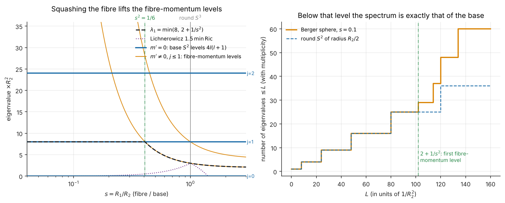

# The SU(2) link with a squashed Hopf fibre: a symmetric top

A fork-level note, not part of the OpenAI release. It computes the Laplace spectrum of `SU(2) = S³` when the Hopf fibre is scaled (a Berger sphere), in the Peter–Weyl basis that [QUANTUM_GRAVITY.md](QUANTUM_GRAVITY.md) and [SU2_LATTICE_GAP.md](SU2_LATTICE_GAP.md) already use, and says how it meets two companion repositories.

**Nothing on this page proves, supports or bears on Yang–Mills existence or a mass gap.** It is a Riemannian spectrum on one copy of `S³`. The squashed metric it studies is not gauge-invariant (see "What this does not say"), so it is not a deformation of the Kogut–Susskind theory either.

## Why this page exists

On the round `S³` (the bi-invariant metric) the Laplacian is `4 C₂ = k² − 1` with `k = 2j + 1`, four times the Casimir `j(j+1)` that the fork reads as the electric energy of a link (`SU2_LATTICE_GAP.md`, which already uses the `S³` Laplacian `k² − 1` on class functions) and as squared area (`QUANTUM_GRAVITY.md`). Two companion repositories found, separately, that the spatial slice of a biaxial Bianchi IX universe is a Berger sphere, the Hopf fibre scaled by `s = R₁/R₂`:

- [brentharts/HopfFibration](https://github.com/brentharts/HopfFibration): `hopf_berger.py`, `hopf_pancake.py` (the collapsing fibre of the pancake cosmology), and `hopf_be_window.py` (the one-link Bakry–Émery tensor of lattice `SU(2)` on round and Berger metrics).
- [brentharts/Quantum_Gravity_Lab](https://github.com/brentharts/Quantum_Gravity_Lab): `qgl_pancake.py`, `qgl_horizon.py` and `qgl_hopf.py`, which follows `s(t)` along its numerical pancake solution.

What was missing is the spectrum of the squashed `S³` in the representation labels the fork uses. It is the spectrum of a quantum symmetric top, and it is short enough to check completely.

## What is checked

Labels follow [HOPF_GAUGE.md](HOPF_GAUGE.md): **Exact** is symbolic or exhaustive arithmetic, **Counted** is a finite count done exactly. The spectrum is a classical fact that is rederived here from the metric; no source was retrieved.

All of it is in `sympy_models/models/su2_berger_top.py` (25 checks). The metric is `g = ¼[R₁²(dψ + cos θ dφ)² + R₂²(dθ² + sin²θ dφ²)]` in Euler angles, `R₁ = R₂ = 1` the unit sphere, `ψ` of period `4π`, and `s = R₁/R₂`.

| Result | Label |
|---|---|
| `√det g = R₁R₂² sin θ / 8` and the volume `2π² R₁R₂²` | Exact |
| `−Δ` acts on the Wigner function `e^{−i(mφ+m'ψ)} d^j_{mm'}(θ)` with eigenvalue `4[(j(j+1) − m'²)/R₂² + m'²/R₁²]`, multiplicity `2j+1` for each `(j, m')`. The Laplacian is computed from the metric in coordinates. | Exact for `j = 1/2, 1` (13 triples); to 40 digits at three points for `j = 3/2` (16 triples) |
| Round limit: `4j(j+1) = k(k+2)` with `k = 2j`, degeneracy `(2j+1)²` | Exact |
| This is the quantum symmetric top, `E = (J(J+1) − K²)/(2I⊥) + K²/(2I∥)`, with `J = j`, `K = m'`, `I⊥ = R₂²/8`, `I∥ = R₁²/8` (`ħ = 1`) | Exact |
| The fibre-constant sector `m' = 0` (integer `j = l`) has eigenvalue `4l(l+1)/R₂² = l(l+1)/(R₂/2)²` for every `R₁`: the Laplacian of the base `S²` of radius `R₂/2`. Checked directly on `P_l(cos θ)`. | Exact |
| Weyl's law `N(Λ) ≈ R₁R₂²Λ^{3/2}/3` by exact counting at `Λ = 20000`, for `s² = 1/16, 1/4, 1, 4, 9` (worst error 0.17%) | Counted |
| First nonzero eigenvalue `λ₁ = min(8, 2 + 1/s²)/R₂²`, crossing at `s² = 1/6`; round value 3 | Exact; brute force over `j ≤ 12` at 13 values of `s²` |
| Lichnerowicz `λ₁ ≥ (3/2) min Ric` for `0 < s < √2`, equality only at `s = 1` (Milnor's Ricci `(2s², 4−2s², 4−2s²)/R₂²` rederived; the two inequalities reduce to `(1−s²)(1+3s²)/s² ≥ 0` and `(3s²−1)(s²−1)/s² ≥ 0`) | Exact |
| Decoupling: for `s² < 1/(L−2)` every eigenvalue `≤ L/R₂²` has `m' = 0`, so the counting function equals that of the `S²` | Counted at `L = 10, 50, 100, 1000`; exact bound |
| On the quotient `SO(3) = S³/{±1}` (integer `j` only): `λ₁ = min(8, 4 + 4/s²)/R₂²`, crossing at `s = 1`; round `RP³` has `λ₁ = 8` | Exact; brute force at the same 13 values |



*Left: levels against `s` (`R₂ = 1`). Flat blue lines are the base `S²` levels `8, 24, …`; orange curves are fibre-momentum levels (`j ≤ 1`), rising like `1/s²`; the dashed line is `λ₁`, the dotted line Lichnerowicz's bound. Right: the counting function at `s = 0.1` coincides with that of the round `S²` of radius `R₂/2` until the first fibre-momentum level at `2 + 1/s² = 102`.* Drawn by `sympy_models/berger_picture.py`, which asserts the plotted numbers.

## What it says about the other pieces

- **Casimir and area (QUANTUM_GRAVITY.md).** Squashing replaces `C₂ = j(j+1)` by the anisotropic `C₂ + (1/s² − 1) m'²`, up to the factor 4. The `(2j+1)²` states of the level `j` split by the fibre weight `m'`, with `±m'` staying degenerate. The fork's area-spectrum statements concern the round (bi-invariant) case and are unaffected.
- **Lichnerowicz equality (`forest_gauge_4d_theorems.py`).** At `s = 1` the equality `λ₁ = (3/2)·Ric = 3` is the `j = 1/2` Casimir `4 · 3/4`. The Berger family shows how the bound degrades: it goes to `0` with the fibre Ricci curvature `2s²` as `s → 0`, while `λ₁` stays at `8`. The bound is not sharp there, because the base `S²` keeps its own gap.
- **The pancake (Quantum_Gravity_Lab).** At leading order `s = a₀t/b₀`, so the fibre-momentum levels sit at about `4m'²/(a₀t)²`, rising without bound as `t → 0`, while the base levels stay at `4l(l+1)/b₀²`. Below any fixed level the spatial Laplacian is that of the base `S²`. That is a statement about the slice at each `t`, not about a field solving an equation on that background. `qgl_hopf.py` shows that the numerical solution (for `a₀ = 1, b₀ = 3, f₀ = 2, m = 0.5`) overshoots `s = 1` (peak about 1.44 near `t = 3.7`) and falls back, so the gap `2 + 1/s²` is not monotone in `t`.
- **`S³` or `SO(3)`.** Quantum_Gravity_Lab's horizon code uses the standard `S³` (fibre period `4π`) and records that whether the pancake paper's slices are `S³` or `SO(3)` is not checked. The last row of the table shows what the question changes in the spectrum: on `SO(3)` the half-integer levels go, including `2 + 1/s²`, and the first fibre-momentum level is `4 + 4/s²`. The spectrum does not decide which one the paper means.
- **The one-link window (`hopf_be_window.py`).** That script finds, at `Q_e = −1`, that the Bakry–Émery window `β_W < min(s⁴, 2 − s²)/3` is largest at the round sphere. It is a statement within the family of left-invariant metrics; see the next section for why that family is not the natural one for gauge theory.

## What this does not say

- **The Berger metric is not gauge-invariant.** A link variable carries two commuting `SU(2)` actions, the gauge transformations at its two ends. The round metric is invariant under both. The Berger metric is left-invariant and right-invariant only under the `U(1)` of the fibre, so it breaks one `SU(2)` to `U(1)`. The symmetric-top Hamiltonian is therefore not a gauge-invariant version of the Kogut–Susskind electric term, and the Bakry–Émery and spectral-gap results for Berger metrics (here and in `hopf_be_window.py`) say nothing about a gauge-invariant lattice theory. They are geometry of `S³`.
- It is silent on Yang–Mills existence and on any mass gap. The spectra here are of one group manifold, with no lattice, no coupling and no volume limit. The fork's status page is [YANGMILLS.md](YANGMILLS.md).
- The identification with a symmetric top is of spectra, not of symmetry: the top has the symmetry of its rotation group and a body-axis `U(1)`, which is the structure above.
- The pancake reading uses the leading-order behaviour `R₁ = a₀t`, `R₂ = b₀`; it does not use the pancake paper's field equations.
- The `j = 3/2` Laplacian check is numerical (40 digits at three points), because sympy does not simplify those expressions to `0`.

## Running

```bash
make berger                         # only these checks (25), a few seconds
cd sympy_models && python3 berger_picture.py ../figures/su2_berger_levels.png    # the figure; needs matplotlib
make sympy                          # every model, including this one
```

Each check raises on failure.

## See also

- [HOPF_GAUGE.md](HOPF_GAUGE.md): the Hopf models and the companion repositories.
- [YM_CONNECTIONS.md](YM_CONNECTIONS.md): every connection to Yang–Mills the fork has checked, ranked by strength (row 10 is this page).
- [QUANTUM_GRAVITY.md](QUANTUM_GRAVITY.md) and [SU2_LATTICE_GAP.md](SU2_LATTICE_GAP.md): the round-metric Casimir this page deforms.
- [HopfFibration](https://github.com/brentharts/HopfFibration) (`YANG_MILLS_LATTICE_GAP.md`, `hopf_be_window.py`) and [Quantum_Gravity_Lab](https://github.com/brentharts/Quantum_Gravity_Lab) (`qgl_hopf.py`, `tests/test_s3_identifications.py`).
