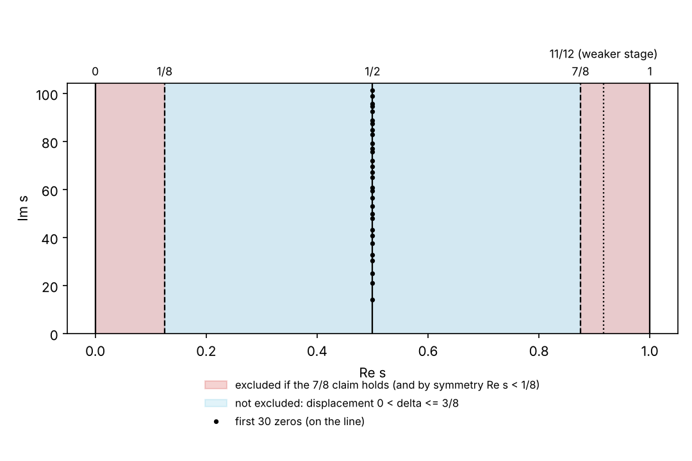
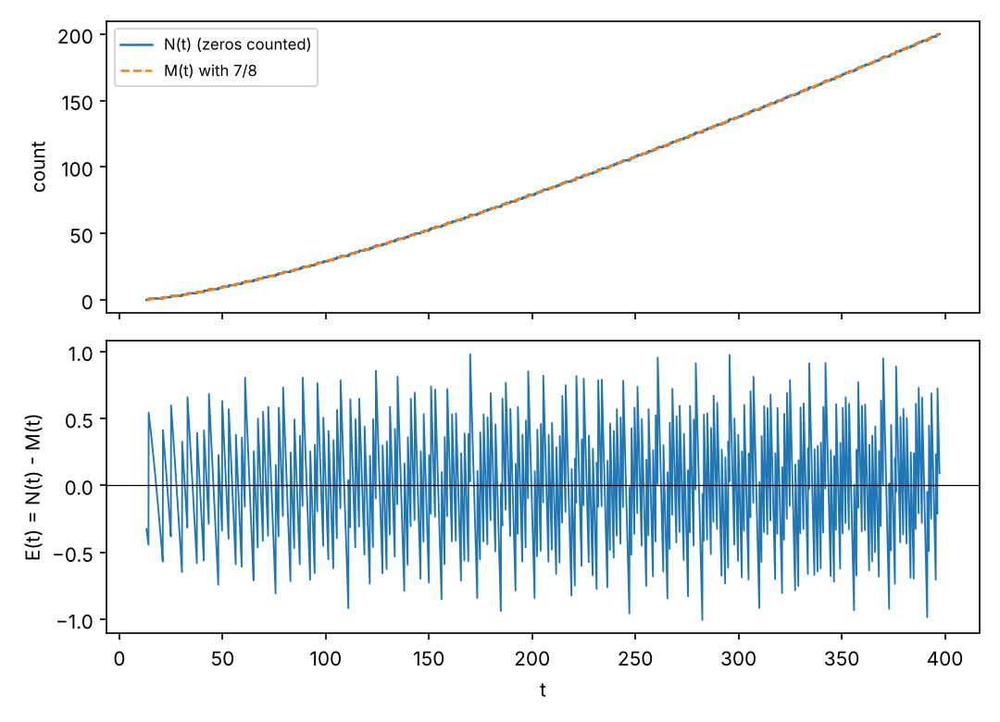

# Where the Zeros Can Be: Entry 003 and the Riemann Research Laboratory

A fork-level reading guide to the repository's claims about the *location* of zeros of ζ and Dirichlet L-functions (entry 003 and its Landau–Siegel companion), and to how they meet a separate project, [brentharts/riemann-research-laboratory](https://github.com/brentharts/riemann-research-laboratory), which studies how Riemann-hypothesis diagnostics respond to hypothetical zeros displaced from the critical line. It is not an official OpenAI document. **Nothing here proves or comes close to proving the Riemann hypothesis.**

**Evidence tags.** **[source]**: stated in a paper or page I read, with section and page numbers as printed. **[repo]**: stated in a file of the laboratory repository (read at its current `main`) or of this repository. **[computed]**: produced by [tools/zeta_strip_figure.py](tools/zeta_strip_figure.py) (`make zeta`). **[mine]**: my comparison or inference. *(background)*: general knowledge, not checked here.

## Citation keys

| Key | Paper | Entry | Notes |
|---|---|---|---|
| **[QRH]** | [The Quasi-Riemann Hypothesis: A Zero-Free Half-Plane ℜs > 7/8](preprints/The-Quasi-Riemann-Hypothesis-September-30-2026/paper.pdf), OpenAI, 30 Sep 2026 | 003 | About 195 pages; Part I (11/12) and Part II (7/8) |
| **[QRH-11/12]** | [The Quasi-Riemann Hypothesis](preprints/The-Quasi-Riemann-Hypothesis-October-5-2026/paper2.pdf), OpenAI, 5 Oct 2026 | 003 | 11/12 half-plane; states itself to be an intermediate step toward [QRH] |
| **[LS]** | [Uniform exclusion of Landau–Siegel zeros](preprints/Uniform-exclusion-of-Landau-Siegel-zeros-October-1-2026/paper.pdf), OpenAI, 1 Oct 2026 | 003 | Real zeros of real characters |
| **[RRL]** | [Riemann Research Laboratory](https://github.com/brentharts/riemann-research-laboratory), files cited by name below | none | Not an OpenAI release |

## What entry 003 claims [source]

**[QRH] Theorem 1.1 (p. 4).** Every finite-order Hecke L-function over ℚ(√−3) has no zero in ℜs > 7/8. The same holds for every Dirichlet L-function, including ζ. A pole at s = 1 for a principal character is allowed. The boundary ℜs = 7/8 is not included. The paper says the theorem "does not establish the Riemann hypothesis or its generalized versions", which place nontrivial zeros on ℜs = 1/2, and that the Riemann hypothesis remains open.

**Consequences stated in the paper [source].**
- With the functional equation, nontrivial zeros of a primitive Dirichlet L-function lie in 1/8 ≤ ℜs ≤ 7/8 ([QRH] Corollary 1.2 proof, p. 7).
- Corollary 1.2: the least positive quadratic nonresidue satisfies n(p) ≤ C(log p)^A, "for example with A = 32", by a conditional result of Bhargava–Ivanyos–Mittal–Saxena that assumes a weak-GRH-type strip. It also gives a deterministic polynomial-time square-root algorithm modulo primes.

**Structure of the proof [source, pp. 4–7].** A common continuation principle (§2): a character sum is bounded directly and is also compared with a Mellin integral containing 1/L of the target; a power saving in both continues the reciprocal across the rightmost possible zero. The input is Patterson's cubic theta series (via Dunn–Radziwiłł's unconditional cusp expansions), a reflection and a Poisson representation of a completed cubic-theta sum, and large-sieve and inverse-moment estimates. Part I proves 11/12 (§11); Part II adds "prime compensation", unequal averaging scales and two further moment estimates, and reaches 7/8 (§20). The Dirichlet statement is transferred from the Hecke one by composing with the norm (quadratic factorization).

**[QRH-11/12] [source].** The October paper proves the 11/12 half-plane for the same families and says its Theorem 1.1 "is a natural intermediate step toward the stronger zero-free region" of [QRH] (introduction). CONTENTS.md describes it as a "different proof"; the paper's own wording is that of an isolated intermediate step. It records a consequence for primes in arithmetic progressions and for Landau–Siegel zeros.

**[LS] Theorem 1 (p. 1) [source].** There is an absolute c > 0 such that every real zero β ∈ (0,1) of every primitive nonprincipal real Dirichlet L-function of conductor q ≥ 3 satisfies (1 − β) log q ≥ c. This is a different argument (a logarithmic-derivative step plus an interpolation-determinant argument over a biquadratic field), and is not stated to depend on [QRH]. The Lean note says no explicit value of c is given, and that real zeros elsewhere in (0,1) are not ruled out [repo, lean/docs/003.md].

**What the 7/8 result does and does not say [mine].** It bounds the supremum of real parts of nontrivial zeros of ζ by 7/8 and so, with the functional equation, confines them to 1/8 ≤ ℜs ≤ 7/8. It does not locate any zero, does not imply that zeros lie on ℜs = 1/2, and says nothing about their imaginary parts or spacing.

## Lean status [repo]

`lean/docs/003.md` says the formalization proves θ = 7/8 for ζ and every Dirichlet L-function (uniformly in modulus and character), the same for finite-order Hecke L-functions over ℚ(√−3), and the uniform real-zero gap of [LS]; the paper's later applications are not included. The comparator statement for ζ is `OAI.riemannZeta_ne_zero_of_seven_eighths_lt_re : 7/8 < s.re → riemannZeta s ≠ 0` ([QuasiRiemannHypothesis.lean](lean/ComparatorChallenges/QuasiRiemannHypothesis.lean)), with a `sorry` stub as in the other comparator files. Under `lean/OAI/NumberTheory/` I count 2,926 files (about 486,600 lines) in `DirichletL` and 3,549 files (about 295,600 lines) in `CubicMoment`, with no `sorry`, `axiom` or `native_decide` by text search. **No build was run here**; the repository contains no build log I read.

## What the laboratory does [repo, RRL]

- **Question.** "How does a controlled, functional-equation-symmetric displacement of hypothetical zeros away from the critical line propagate quantitatively through different RH diagnostics?" (README.md). The project says it does not claim to prove RH and distinguishes KNOWN THEOREM, KNOWN CONJECTURE, EQUIVALENT CRITERION, HEURISTIC, COMPUTATIONAL OBSERVATION, PROJECT CONJECTURE, PROVED IN PROJECT and FAILED CLAIM.
- **Zero surgery** (`docs/ZERO_SURGERY_SPECIFICATION.md`). For 0 < δ < ½ and ordinate γ, a quartet of synthetic zeros ½ ± δ ± iγ is the functional-equation orbit of ½ + δ + iγ. The specification states that this does not by itself define a modified zeta or xi function ("Level I").
- **Current paper** (`FINAL_PROJECT_STATUS.md`): "Matched-Scale Li Susceptibility and Centered-Primitive Transfer of Zero-Counting Discrepancy". Main theorem: R_int(n; H, η) = O(log H / H³) uniformly for n/H in a compact set, unconditionally, using the Riemann–von Mangoldt count, the classical S₁(t) = O(log t), a Li susceptibility profile, and a centered primitive of E(t) = N(t) − M(t); under RH a log log H refinement. Status in the project's own words: ready for mentor review, not ready for submission, originality under prior-art review; it "does not make progress toward proving RH". Its next-steps file says not to add phases.
- **Claim discipline.** `docs/NOVELTY_CLAIM_QUARANTINE.md` forbids phrases such as "breakthrough" or "progress toward solving the Riemann Hypothesis".

## How the two meet

| Question | Answer | Tag |
|---|---|---|
| Does [QRH] change the laboratory's main theorem? | **No.** The theorem is stated through E(t) = N(t) − M(t) and S₁(t) and does not use any zero-free region. | [mine], from `paper/01_SCOPE_AND_MAIN_RESULT.md` |
| Does [QRH] constrain the surgery parameter δ? | **For the interpretation "hypothetical actual zero of ζ", yes**: if [QRH] holds, a zero at ½ + δ + iγ needs δ ≤ 3/8. The synthetic surgery is not claimed to be zeros of a zeta function, so numerical experiments with larger δ are not contradicted. | [mine] |
| Does [QRH] touch the RH-conditional refinement? | Not directly. The refinement assumes RH. A version assuming only ℜρ ≤ θ is a natural question; I did not check whether it is known or whether the method gains anything for θ < 1. | [mine] — a question for a prior-art audit |
| Can the laboratory cite [QRH] as a known result? | Not under its own rules: [QRH] is an unrefereed OpenAI preprint whose proof I have not checked. The laboratory has since adopted a distinct ledger status, UNREFEREED EXTERNAL CLAIM (entries CL-E001 to CL-E003), and records the claims in its `docs/EXTERNAL_RESULTS_REGISTER.md`. | [repo] |
| Does the laboratory's quadratic approximation stay meaningful up to δ = 3/8? | **In one-quartet numerical tests, yes at matched scale**; see the next section. | [computed in RRL], [mine] |

The first rows are the reason the plan's step 3 proposes a one-page register in the laboratory, not a new phase.

## The quadratic response up to δ = 3/8 [repo, RRL; computed]

`paper/latex/main.tex` defines R_f(δ,γ) = Σ f(½ ± δ ± iγ) − 2 Σ f(½ ± iγ) and states R_f = δ²χ_f(γ) + O(δ⁴) with χ_n^Li(γ) = 2 Re f_n″(½ + iγ) for the Li kernel f_n(z) = 1 − (1 − 1/z)ⁿ. It gives no range of δ for the remainder. Its main theorem, on R_int(n;H,η) = −∫ E(t) χ_n′(t) dt, contains no δ at all, so the δ-range affects only the interpretation of χ_n as a displaced-quartet response.

I ran the laboratory's own code for the exact orbit response and for χ_n (new script `experiments/li_quadratic_response_delta_range.py`, 60-digit mpmath), and the laboratory recorded the result as CL-E004 in its ledger. Over 100 values of n/γ in [0.1, 10], the worst error |R − δ²χ_n| / (δ² A_n), normalized by the amplitude envelope A_n of χ_n, is:

| γ | δ = 0.125 | δ = 0.25 | δ = 0.375 |
|---|---|---|---|
| 14.13 (first zero) | 7.3e-4 | 2.9e-3 | **6.6e-3** |
| 100 | 1.5e-5 | 6.0e-5 | 1.4e-4 |
| 1000 | 1.5e-7 | 6.0e-7 | 1.4e-6 |

At fixed δ the error falls like 1/γ² over these heights. Outside the matched-scale window (n = kγ² at γ₁, δ = 3/8) the relative error to χ_n is 5.1% at k = 1 and 39% at k = 3; the natural small parameter is nδ/γ², from the exact identity |1 − 1/z|² = 1 − 2δ/|z|² for z = ½ + δ + iγ. Limits: one quartet and a finite grid; no aggregate over many zeros; the envelope normalization hides relative error near blind scales; nothing here says an actual zero with such a δ exists. Details are in the laboratory's `docs/QUADRATIC_RESPONSE_DELTA_RANGE.md`.

## A small check [computed]

[tools/zeta_strip_figure.py](tools/zeta_strip_figure.py) computes the first 200 zeros of ζ with mpmath (ordinates 14.134725 … 396.381854) and compares the counting function N(t) with the laboratory's smooth term M(t) = (t/2π) log(t/2π) − t/2π + 7/8:

| Quantity | Value |
|---|---|
| E(t) = N(t) − M(t) at midpoints between consecutive zeros | between −0.327 and +0.328, mean +0.001 |
| E(t) just before and after each jump of N | between −1.005 and +0.980 |
| Functional-equation orbit at δ = 3/8, γ = γ₁ | real parts {1/8, 7/8}, with all four conjugate and reflected points consistent |





This is a sanity check of indexing, of M(t), and of the orbit arithmetic. mpmath's `zetazero` finds the n-th zero on the critical line, so it does not test the Riemann hypothesis, and 200 zeros say nothing about E(t) at large t.

## Other entries [repo]

- Entry 006 (Goldfeld's conjecture) and entry 002 (BSD, Selmer converse) concern L-functions of elliptic curves at the central point and analytic rank, not the location of zeros off the line.
- Entry 007 (two-point Chowla and the corrected Elliott conjecture) is about multiplicative functions and correlations. I did not look for a link to zero locations.
- [LANGLANDS.md](LANGLANDS.md) and [RECONSTRUCTION_AND_DECIDABILITY.md](RECONSTRUCTION_AND_DECIDABILITY.md) cover entries 010, 014, 030 and 004, which involve automorphic L-functions and modularity but make no statement about zero-free regions.

## Evidence status

| Statement | Status |
|---|---|
| Theorems, structure and consequences of [QRH], [QRH-11/12], [LS] | [source], from the introductions and abstracts as extracted; I did not read the proofs |
| Lean file counts and `sorry` search | Observations; no build was run |
| Description of the laboratory | [repo], from its README, final status, next-steps, zero-surgery, quarantine and scope files, and the introduction of `paper/latex/main.tex` (its proofs were not read); I ran the laboratory's susceptibility code for the δ-range check only |
| Comparison between the two | [mine] |
| Correctness of entry 003 | **Not assessed**; it is an unrefereed preprint |

## Caveats

- The 7/8 half-plane is a large claim in an unrefereed preprint. Everything conditional on it should say so.
- The laboratory's results are independent of it, and should stay that way unless the project chooses otherwise.
- Page numbers are printed numbers of the extracted text.

## Open questions

- Does the laboratory's RH-conditional refinement have a θ-version for zeros in ℜρ ≤ θ, and is that known?
- Does the aggregate response over many zeros, not just one quartet, stay accurate for δ up to 3/8? (One-quartet tests above say yes at matched scale.)
- What precisely does [LS]'s constant c depend on, and is any effective value claimed?

## Reproducing this page

```
make zeta       # python3 tools/zeta_strip_figure.py --nzeros=200 --figures  (about 30 s; needs mpmath)
```

## Related pages

- [CONTENTS.md](CONTENTS.md), entry 003.
- [LANGLANDS.md](LANGLANDS.md) for the automorphic side.
- [tools/README.md](tools/README.md) for the other scripts.
